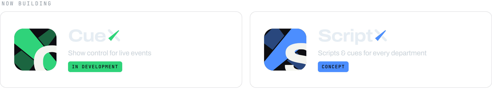
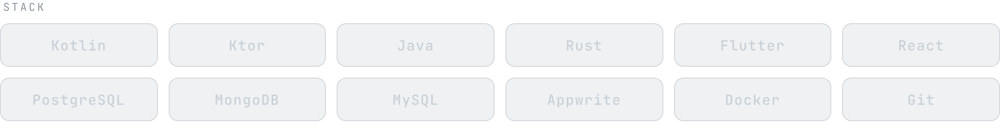

<picture>
  <source media="(prefers-color-scheme: light)" srcset="assets/banner-hell-v4.svg">
  
</picture>

  

  <a href="https://github.com/NeXuera"><picture><source media="(prefers-color-scheme: light)" srcset="assets/link-nexvent-hell-v4.png"></picture></a>&nbsp;
  <a href="https://linkedin.com/in/felix-ehnert-ab33bb39b"><picture><source media="(prefers-color-scheme: light)" srcset="assets/link-linkedin-hell-v4.png"></picture></a>&nbsp;
  <a href="https://instagram.com/felix.ehn"><picture><source media="(prefers-color-scheme: light)" srcset="assets/link-instagram-hell-v4.png"></picture></a>&nbsp;
  <a href="https://hub.docker.com/u/felixehn"><picture><source media="(prefers-color-scheme: light)" srcset="assets/link-dockerhub-hell-v4.png"></picture></a>

 

Dual student in Business Informatics at **DHBW Mosbach** – Application Management & Applied AI. 
I build software for live events and work in event technology myself.

 

<picture>
  <source media="(prefers-color-scheme: light)" srcset="assets/projects-hell-v4.png">
  
</picture>

  

<picture>
  <source media="(prefers-color-scheme: light)" srcset="assets/stack-hell-v4.png">
  
</picture>

  

<picture>
  <source media="(prefers-color-scheme: light)" srcset="assets/offstage-hell-v4.png">
  
</picture>

  

  <picture><source media="(prefers-color-scheme: light)" srcset="assets/x-hell-v4.svg"></picture>

