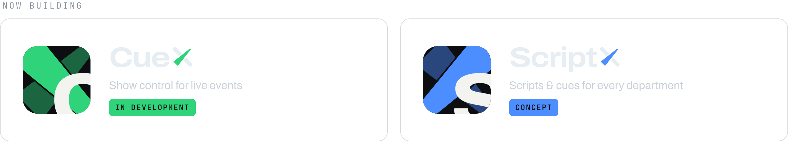
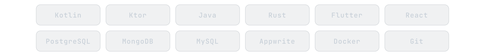

<picture>
  <source media="(prefers-color-scheme: dark)" srcset="assets/banner-dunkel.png">
  <source media="(prefers-color-scheme: light)" srcset="assets/banner-hell.png">
  
</picture>

 

  <a href="https://linkedin.com/in/felix-ehnert-ab33bb39b"><picture><source media="(prefers-color-scheme: light)" srcset="assets/link-linkedin-hell.png"></picture></a>&nbsp;
  <a href="https://instagram.com/felix.ehn"><picture><source media="(prefers-color-scheme: light)" srcset="assets/link-instagram-hell.png"></picture></a>&nbsp;
  <a href="https://hub.docker.com/u/felixehn"><picture><source media="(prefers-color-scheme: light)" srcset="assets/link-dockerhub-hell.png"></picture></a>

 

Dual student in Business Informatics at **DHBW Mosbach** – Application Management & Applied AI. 
I build software for live events and work in event technology myself. Volunteer at the **THW**.

 

<picture>
  <source media="(prefers-color-scheme: light)" srcset="assets/projects-hell.png">
  
</picture>

  

<picture>
  <source media="(prefers-color-scheme: light)" srcset="assets/stack-hell.png">
  
</picture>

  

  <picture><source media="(prefers-color-scheme: light)" srcset="assets/x-hell.svg"></picture>

